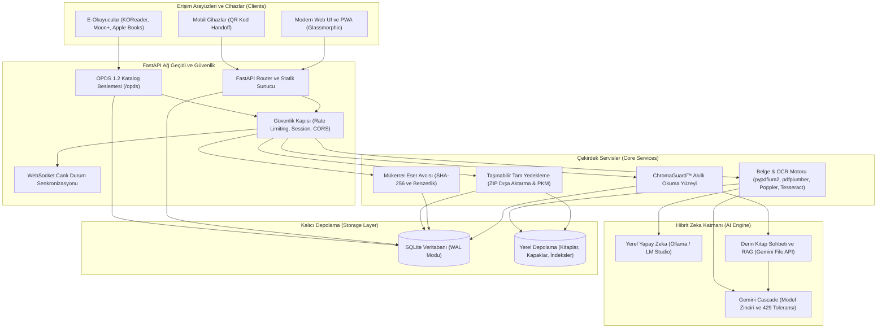

# Digital Library (Dijital Kütüphane)

[](LICENSE)
[](https://www.python.org/)
[](https://fastapi.tiangolo.com/)
[](docker-compose.yml)
[](https://www.sqlite.org/)

A high-performance, AI-powered digital library management system built with FastAPI and SQLite. Features advanced semantic search (RAG), automated document analysis, ChromaGuard™ reading surface, OPDS 1.2 cataloging, cross-device mobile handoff, and duplicate detection.

[**English**](#english) | [**Türkçe**](#türkçe) | [**Architecture / Mimari**](#architecture) | [**📖 Kapsamlı Kullanım Kılavuzu (KULLANIM_KILAVUZU.md)**](KULLANIM_KILAVUZU.md)

---

<a name="architecture"></a>
## Architecture / Sistem Mimarisi



---

<a name="english"></a>
## English

### Core Features
- **ChromaGuard™ Smart Reading Surface**: Advanced visual reading engine offering Day, Sepia, E-Ink, and Night modes with eye-strain reduction, contrast balancing, and responsive typography.
- **OPDS 1.2 Catalog**: Standardized wireless library feed (`/opds`) with full support for KOReader, Moon+ Reader, Apple Books, and hardware e-readers.
- **Gemini Cascade Architecture**: Multi-tier AI fallback engine across Gemini models (`gemini-3.8-flash` to `gemini-3.5-flash-lite`) with intelligent HTTP 429 rate limit tolerance and exponential backoff retry.
- **Mobile Handoff**: Cross-device continuity via dynamic QR codes—scan with your phone to instantly resume reading at your exact page and position.
- **Duplicate Book Hunter & PDF Optimizer**: SHA-256 hashing and title/author similarity matching to detect duplicates, plus local in-place PDF compression.
- **Portable Full Backup & PKM Export**: One-click ZIP backup (database, configuration, and library files) alongside Obsidian (`.md`), Anki (`.tsv`), and BibTeX (`.bib`) exports.
- **Hybrid AI Architecture**: Seamless integration with Google Gemini (Cloud) and Ollama / LM Studio / OpenAI-compatible APIs for metadata extraction, summarization, and tag generation.
- **Deep Book Chat, FTS5 Search & Auto TOC**: Context-aware workspace companion (Gemini File API / full-text RAG), instant page-level FTS5 deep search, and automatic PDF TOC & page-offset resolution.
- **Multi-Format Processing & Watchfolder**: PDF, EPUB, and TXT support via `pypdfium2`, `pdfplumber`, Poppler, and Tesseract OCR, plus automated watchfolder monitoring and optional PyWebView desktop shell.
- **Collection Management & Telegram Sync**: Static and rule-based dynamic collections, JSON/Markdown sharing, and Telethon Telegram document synchronization.
- **Modern UI & PWA**: Glassmorphic design with dynamic `theme-color` meta synchronization, live WebSocket task/log streaming, keyboard accessibility, and offline-ready PWA support.

### User Guide
For complete setup, Gemini API key acquisition, and Telegram integration instructions, see [**KULLANIM_KILAVUZU.md**](KULLANIM_KILAVUZU.md).

### Deployment

#### Option 1: Docker (Recommended)
The fastest way to deploy the system with all dependencies pre-installed.
```bash
cp .env.example .env
# Edit .env with your settings
docker compose up -d --build
```

#### Option 2: Windows (Native)
Run the all-in-one setup and launch script in the root directory:
- Simply double-click **`BASLAT.bat`**. It will automatically set up the virtual environment, install requirements, and launch the digital library.

#### Option 3: Linux/macOS (Native)
```bash
chmod +x docs/alternatif_kurulum/install.sh
./docs/alternatif_kurulum/install.sh
```

### Configuration
Key environment variables in `.env`:
| Variable | Description | Default |
|----------|-------------|---------|
| `GEMINI_API_KEY` | API Key for Cloud AI features | None |
| `ACCESS_PASSWORD` | Access password (**Required for Docker / Remote Deployments**) | Protected (localhost only if empty) |
| `ALLOW_UNPROTECTED_REMOTE_ACCESS` | Explicitly allow remote access without password (not recommended) | `False` |
| `ALLOWED_ORIGINS` | CORS allowed origins | http://localhost:8000 |

---

<a name="türkçe"></a>
## Türkçe

### Temel Özellikler
- **ChromaGuard™ Akıllı Okuma Yüzeyi**: Göz yorgunluğunu önleyen Gündüz, Sepya, E-Ink ve Gece renk modları; dinamik kontrast ve akıllı tipografi optimizasyonu.
- **OPDS 1.2 Kataloğu**: KOReader, Moon+ Reader, Apple Books ve uyumlu e-okuyucu cihazlar için kablosuz doğrudan kütüphane akışı sağlayan standart OPDS desteği (`/opds`).
- **Gemini Cascade Mimarisi**: Gemini modelleri (`gemini-3.8-flash` → `gemini-3.5-flash-lite`) arasında akıllı yedekleme zinciri (fallback) ve HTTP 429 kota aşımlarına karşı üstel geri çekilmeli otomatik yeniden deneme mekanizması.
- **Mobil Handoff**: Masaüstünde okunan kitabın sayfasını QR kod ile anında mobil cihaza aktarma ve okumaya mobilde kalınan sayfadan kesintisiz devam edebilme.
- **Çift Kitap Avcısı & PDF Optimize Edici**: SHA-256 hash ve başlık/yazar benzerliği ile mükerrer kitapları tespit edip temizleme ve büyük PDF dosyalarını yerel olarak sıkıştırma.
- **Taşınabilir Tam Yedekleme & PKM Dışa Aktarma**: Veritabanı, ayarlar ve kitapları tek tıkla ZIP yedeği olarak dışa aktarma; notları Obsidian (`.md`), Anki (`.tsv`) ve BibTeX (`.bib`) formatlarına çevirme.
- **Hibrit Zeka Mimarisi**: Kitap analizi ve metaveri çıkarma süreçlerinde Google Gemini (Bulut) veya Ollama / LM Studio / OpenAI uyumlu yerel modeller ile tam entegrasyon.
- **Derin Kitap Sohbeti, FTS5 Arama & Otomatik TOC**: Gemini File API ve tam metin bağlamı ile kitap içi sohbet, FTS5 sayfa içi tam metin arama ve otomatik içindekiler/sayfa sapması çözümü.
- **Çoklu Format, OCR & Gölge Kütüphaneci**: `pypdfium2`, `pdfplumber`, Poppler ve Tesseract OCR ile PDF, EPUB ve TXT işleme; Watchfolder klasör izleme ve isteğe bağlı PyWebView masaüstü kabuğu.
- **Koleksiyon Yönetimi & Telegram Senkronizasyonu**: Statik ve kural tabanlı dinamik koleksiyonlar, JSON/Markdown paylaşımı ve Telethon ile Telegram'dan kitap aktarımı.
- **Modern Arayüz & PWA**: Responsive tasarım, WebSocket canlı işlem/log akışı, dinamik `theme-color` senkronizasyonu ve çevrimdışı destekli PWA arayüzü.

### Kullanım ve Kurulum Kılavuzu
Sıfırdan kurulum, Google Gemini API anahtarı alma ve Telegram kitap aktarımı dahil eksiksiz rehber için [**KULLANIM_KILAVUZU.md**](KULLANIM_KILAVUZU.md) dosyasını inceleyin.

### Kurulum

#### Seçenek 1: Docker (Önerilen)
Tüm bağımlılıkların hazır olduğu en hızlı kurulum yöntemidir.
```bash
cp .env.example .env
# .env dosyasını düzenleyin
docker compose up -d --build
```

#### Seçenek 2: Windows (Yerel)
Ana dizindeki tek tıkla kurulum ve başlatma aracını kullanın:
- Doğrudan **`BASLAT.bat`** dosyasına çift tıklayın. Sanal ortamı otomatik oluşturup kütüphaneleri yükler ve tarayıcıda kütüphanenizi açar.

#### Seçenek 3: Linux/macOS (Yerel)
```bash
chmod +x docs/alternatif_kurulum/install.sh
./docs/alternatif_kurulum/install.sh
```

### Yapılandırma
`.env` dosyasındaki temel değişkenler:
| Değişken | Açıklama | Varsayılan |
|----------|----------|------------|
| `GEMINI_API_KEY` | Gemini AI özellikleri için API anahtarı | Yok |
| `ACCESS_PASSWORD` | Kütüphane giriş şifresi (**Docker ve Dış Ağ için Zorunlu**) | Korumalı (boşsa yalnızca localhost erişebilir) |
| `ALLOW_UNPROTECTED_REMOTE_ACCESS` | Uzaktan şifresiz erişime açıkça izin ver (Önerilmez) | `False` |
| `ALLOWED_ORIGINS` | CORS izinli adresler | http://localhost:8000 |

---

### Documentation / Belgeler
Additional project guidelines and history can be found in the [`docs/`](docs/) directory:
- [Contributing Guide (Katkı Rehberi)](docs/CONTRIBUTING.md)
- [Code of Conduct (Davranış Kuralları)](docs/CODE_OF_CONDUCT.md)
- [Security Policy (Güvenlik Politikası)](docs/SECURITY.md)
- [Changelog (Değişiklik Günlüğü)](docs/CHANGELOG.md)

---

### License
This project is licensed under the MIT License - see the [LICENSE](LICENSE) file for details.
