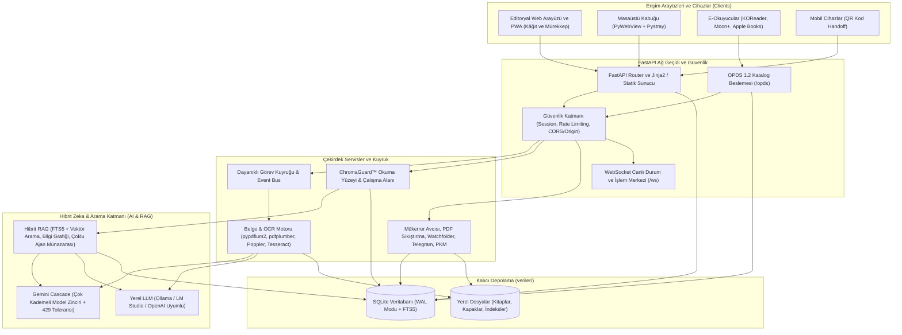

# Dijital Kütüphane (Digital Library)

[](LICENSE)
[](https://www.python.org/)
[](https://fastapi.tiangolo.com/)
[](https://www.sqlite.org/)
[](docker-compose.yml)

**Yerel öncelikli, yapay zeka destekli kişisel dijital kütüphane ve araştırma çalışma alanı.**  
PDF, EPUB ve TXT arşivlerinizi kendi bilgisayarınızda veya sunucunuzda saklar; metaveri çıkarımı, tam metin arama (FTS5 + vektör RAG), kitap içi sohbet, OCR, OPDS 1.2 ve mobil aktarım özelliklerini tek bir editoryal arayüzde sunar.

> *A local-first, AI-powered personal digital library and research workspace built with FastAPI and SQLite (WAL + FTS5). Designed around an editorial "Paper & Ink" interface with hybrid Cloud/Local AI, ChromaGuard™ reading modes, OPDS 1.2 cataloging, and QR mobile handoff.*

[**Türkçe**](#türkçe) · [**English**](#english) · [**Sistem Mimarisi**](#architecture) · [**Proje Yapısı**](#project-structure) · [**Geliştirme & Test**](#development) · [**📖 Kullanım Kılavuzu**](KULLANIM_KILAVUZU.md)

---

<a id="türkçe"></a>
## Türkçe

### Neden Dijital Kütüphane?

- **Tam Veri Sahipliği:** Kitaplarınız, kapak görselleriniz, notlarınız ve SQLite veritabanınız yalnızca yerel `veriler/` dizininde tutulur; üçüncü parti bir bulut kütüphanesine bağımlı değildir.
- **Hibrit Yapay Zeka:** İster **Google Gemini** (ücretsiz katman dahil, kademeli model zinciriyle) ister **Ollama / LM Studio** (OpenAI uyumlu yerel modeller) ile tamamen çevrimdışı çalışır.
- **"Kâğıt ve Mürekkep" (Paper & Ink) Editoryal Arayüzü:** Koyu SaaS panelleri yerine sıcak kâğıt tonları, toprak vurgular, `Instrument Serif` / `Newsreader` / `Geist` tipografisi ve harici JS framework'ü olmadan geliştirilen mekânsal View Transitions geçişleri kullanır.

### Öne Çıkan Özellikler

#### Okuma ve Araştırma Çalışma Alanı
- **ChromaGuard™ Akıllı Okuma Yüzeyi:** Gündüz, Sepya, E-Ink ve Gece modlarıyla göz yorgunluğunu azaltan kontrast dengesi ve duyarlı tipografi.
- **Akıllı Çalışma Alanı (Workspace):** Metin seçerek not ve renkli vurgu alma, otomatik PDF İçindekiler (TOC) çıkarımı ve sayfa sapması (offset) çözümleme.
- **Mobil Handoff:** Masaüstünde açık olan kitabın tam sayfa konumunu dinamik QR kod ile telefonunuza aktarıp kesintisiz devam etme.
- **OPDS 1.2 Kablosuz Katalog (`/opds`):** KOReader, Moon+ Reader, Apple Books ve uyumlu e-okuyucular için standart katalog akışı.

#### Hibrit Yapay Zeka, Arama ve Keşif
- **Gemini Cascade Motoru:** Modeller (`gemini-3.8-flash` → `gemini-3.5-flash-lite`) arasında otomatik yedekleme zinciri ve HTTP 429 kota aşımlarına karşı üstel geri çekilmeli yeniden deneme.
- **Derin Kitap Sohbeti (RAG) & Hibrit Arama:** SQLite **FTS5** sayfa içi tam metin araması, metin parçalama/vektör gömme (`chunking_service`, `embedding_service`, `hybrid_search`) ve Gemini File API bağlam desteği.
- **Bilgi Grafiği, Çoklu Ajan Münazarası & Keşif:** Kavram ilişkileri (`knowledge_graph`), çoklu ajan tartışma akışı (`multi_agent_debate`) ve tesadüfi keşif motoru (`serendipity_engine`).
- **Otomatik Analiz:** Yüklenen eserlerden başlık, yazar, kategori, etiket ve kapsamlı özet üretimi.

#### İçe Aktarma, Otomasyon ve Bakım
- **Çoklu Format & OCR:** `pypdfium2`, `pdfplumber` ve Poppler ile PDF, EPUB ve TXT işleme; taranmış PDF'ler için **Tesseract OCR**.
- **Canlı İşlem Merkezi:** WebSocket (`/ws`) üzerinden anlık görev kuyruğu, ilerleme yüzdesi ve terminal log akışı; çökme sonrası kurtarma destekli dayanıklı kuyruk (`durable_queue`).
- **Gölge Kütüphaneci (Watchfolder):** Belirlenen klasöre düşen yeni PDF/EPUB dosyalarını otomatik algılayıp kuyruğa alma.
- **Telegram Senkronizasyonu:** Telethon aracılığıyla Telegram mesaj/kanallarından doğrudan kitap aktarımı.
- **Mükerrer Eser Avcısı & PDF Optimize Edici:** SHA-256 hash ve başlık/yazar benzerliği ile çift kopya tespiti; yerel PDF boyut sıkıştırma.
- **Taşınabilir Yedekleme & PKM Dışa Aktarma:** Veritabanı, ayarlar ve kitaplar için tek tıkla ZIP yedeği; notları **Obsidian** (`.md`), **Anki** (`.tsv`) ve **BibTeX** (`.bib`) olarak dışa aktarma.

#### Güvenlik, Masaüstü ve PWA
- **Yerel ve Uzak Erişim Güvenliği:** SQLite WAL modu, parola kapısı (`ACCESS_PASSWORD`), imzalı oturum çerezleri (`SESSION_SECRET`), brute-force hız sınırlama ve CORS/Origin doğrulaması.
- **Çevrimdışı Hazır PWA & Masaüstü Kabuğu:** Service Worker (`static/sw.js`) ile PWA desteği ve isteğe bağlı **PyWebView + Pystray** masaüstü uygulaması (`desktop_shell.py`).

### Hızlı Başlangıç

#### Seçenek 1: Docker / Docker Compose (Önerilen)
Poppler, Tesseract OCR (`tur` + `eng`) ve tüm Python bağımlılıkları hazır gelir.

```bash
cp .env.example .env
# ÖNEMLİ: Docker dış ağa açık çalıştığı için .env içinde güçlü bir ACCESS_PASSWORD tanımlayın.
docker compose up -d --build
```
Sunucu hazır olduğunda `http://localhost:8000` adresinden erişebilirsiniz (`/health` uç noktası konteyner sağlık kontrolünü sağlar; kalıcı veriler `./veriler` klasöründe tutulur).

#### Seçenek 2: Windows Tek Tıkla Kurulum (`BASLAT.bat`)
1. Python 3.10+ kurulumunda **`Add python.exe to PATH`** seçeneğini işaretleyin.
2. Proje ana dizinindeki **`BASLAT.bat`** dosyasına çift tıklayın.
   - Sanal ortamı (`.venv` veya `%USERPROFILE%\.dijital_kutuphane_venv`) oluşturur,
   - `requirements.txt` bağımlılıklarını kurar,
   - `.env` dosyasını otomatik hazırlar ve `http://localhost:8000` adresini tarayıcıda açar.

#### Seçenek 3: Linux / macOS Kurulumu
Otomatik kurulum betiğini kullanabilir veya manuel kurabilirsiniz:
```bash
chmod +x docs/alternatif_kurulum/install.sh
./docs/alternatif_kurulum/install.sh
```
<details>
<summary>Manuel Python kurulum adımları (Linux / macOS / Windows)</summary>

```bash
python3 -m venv .venv
source .venv/bin/activate        # Windows: .venv\Scripts\activate
pip install -r requirements.txt
cp .env.example .env
python main.py
```

</details>

#### Seçenek 4: Masaüstü Uygulaması Modu (PyWebView + Sistem Tepsisi)
```bash
pip install -e ".[desktop]"
python desktop_shell.py
```

#### İlk Kurulum Sonrası 3 Adım
1. Tarayıcıda **`http://localhost:8000`** adresini açın.
2. Sağ üst köşedeki **⚙️ Ayarlar** penceresinden **Google Gemini** API anahtarınızı girin veya **Ollama / LM Studio** yerel sunucu adresinizi seçin.
3. İlk PDF, EPUB veya TXT dosyanızı sürükleyip bırakın; sağ üstteki **İşlem Merkezi** kapsülünden canlı analiz sürecini izleyin.

> [!TIP]
> Taranmış (görsel tabanlı) PDF'ler için sisteminizde **Tesseract OCR** ve **Poppler** kurulu olması önerilir. Ayrıntılı anlatım, Gemini API anahtarı alma ve Telegram kurulumu için [**KULLANIM_KILAVUZU.md**](KULLANIM_KILAVUZU.md) rehberine bakın.

### Yapılandırma (`.env`)

Tüm şablon değişkenleri [`.env.example`](.env.example) dosyasında belgelenmiştir:

| Değişken | Açıklama | Varsayılan |
|----------|----------|------------|
| `PORT` / `HOST` | Sunucu portu ve dinleme adresi | `8000` / `127.0.0.1` (`.env.example`: `0.0.0.0`) |
| `ACCESS_PASSWORD` | Kütüphane giriş parolası (**Docker ve uzak erişim için zorunlu**) | Boş (yalnızca `localhost` erişebilir) |
| `ALLOW_UNPROTECTED_REMOTE_ACCESS` | Uzaktan şifresiz erişime açıkça izin ver (**önerilmez**) | `False` |
| `SESSION_SECRET` | Oturum çerezi imzalama anahtarı (boşsa `veriler/.session_secret` üretilir) | Otomatik üretilir |
| `GEMINI_API_KEY` | Google Gemini bulut AI anahtarı (Ayarlar menüsünden de girilebilir) | Yok |
| `ALLOWED_ORIGINS` | CORS / WebSocket için izinli origin listesi | `http://127.0.0.1:8000,http://localhost:8000` |
| `MAX_UPLOAD_MB` | Maksimum dosya yükleme boyutu (MB) | `250` |
| `MAX_CONCURRENT_TASKS` | Eşzamanlı arka plan görev sayısı | `1` |
| `TELEGRAM_API_ID` / `TELEGRAM_API_HASH` | Telethon ile Telegram kitap aktarımı kimlik bilgileri | Yok |
| `TRUST_PROXY` | Nginx / Traefik / Cloudflare arkasında `X-Forwarded-*` güveni | `False` |
| `LOG_LEVEL` | Günlükleme seviyesi (`DEBUG`, `INFO`, `WARNING`, `ERROR`) | `INFO` |

> [!IMPORTANT]
> Güvenlik gereği `ACCESS_PASSWORD` boş bırakıldığında uygulama yalnızca yerel (`localhost` / `127.0.0.1`) isteklere izin verir; dış ağdan gelen istekler `403` ile reddedilir.

---

<a id="architecture"></a>
## Sistem Mimarisi / Architecture



---

<a id="project-structure"></a>
## Proje Yapısı / Project Structure

```text
.
├── main.py                      # FastAPI sunucu giriş noktası
├── desktop_shell.py             # İsteğe bağlı PyWebView + Pystray masaüstü kabuğu
├── BASLAT.bat                   # Windows tek tıkla kurulum ve başlatma betiği
├── Dockerfile & docker-compose.yml
├── pyproject.toml               # Proje meta verisi, ruff / black / mypy / pytest ayarları
├── requirements.txt             # Çalışma zamanı bağımlılıkları
├── requirements-dev.txt         # Geliştirme ve test bağımlılıkları
├── KULLANIM_KILAVUZU.md         # Adım adım son kullanıcı kurulum & kullanım rehberi
│
├── app/
│   ├── main.py                  # Lifespan, middleware, auth/origin korumaları, /ws
│   ├── config.py & constants.py # Ortam değişkenleri, sınırlar, yol çözümleme
│   ├── database.py & models.py  # SQLite WAL şeması, FTS5 tabloları ve modeller
│   ├── auth.py                  # Oturum doğrulama ve brute-force koruması
│   ├── task_queue.py, durable_queue.py, event_bus.py, tasks.py, websocket.py
│   ├── pdf.py & epub.py         # PDF/EPUB metin, kapak ve sayfa işleme
│   ├── routers/                 # HTTP uç noktaları: auth, books, chat, collections,
│   │                            # debate, opds, settings, tasks, telegram
│   ├── repositories/            # document_repository.py (veri erişim katmanı)
│   └── services/                # ai_service, cascade_manager, chunking_service,
│                                # embedding_service, hybrid_search, knowledge_graph,
│                                # multi_agent_debate, serendipity_engine, toc_service,
│                                # handoff_service, pdf_compressor, pkm_exporter,
│                                # smart_collections, telegram_service, watchfolder_service
│
├── templates/                   # Jinja2 HTML şablonları (kutuphane.html, login.html vb.)
├── static/
│   ├── sw.js                    # PWA Service Worker (önbellek sürümleme)
│   ├── css/
│   │   ├── app.css              # Cascade katmanları: @layer legacy, tokens, design, motion
│   │   ├── style.css            # Temel yapısal stiller (legacy)
│   │   ├── tokens.css           # Renk, tipografi ve hareket token'ları
│   │   ├── design.css           # "Kâğıt ve Mürekkep" bileşenleri ve duyarlı yerleşim
│   │   └── motion.css           # Merkezi hareket kuralları ve reduced-motion desteği
│   └── js/                      # Framework'süz modüler JS (state, motion, api, websocket, ui_*)
│
├── docs/                        # CHANGELOG, MOTION_NOTES, CONTRIBUTING, SECURITY, install.sh
└── tests/                       # Pytest birim, güvenlik, API, RAG, OPDS ve arayüz testleri
```

---

<a id="development"></a>
## Geliştirme ve Test / Development & Testing

### Geliştirici Kurulumu
```bash
pip install -r requirements-dev.txt
pip install -e .
```

### Lint ve Test Komutları
Proje CI akışı ([`.github/workflows/ci.yml`](.github/workflows/ci.yml)) Python 3.10–3.13 üzerinde Linux ve Windows için `ruff` ve `pytest` çalıştırır:
```bash
# Kod kalitesi ve stil kontrolü
ruff check .

# Tüm test paketi
pytest -v tests/
```

### Frontend Mimarisi Notları
- Harici bundler veya JS framework'ü yoktur; [static/css/app.css](static/css/app.css) içindeki `@layer legacy, tokens, design, motion;` sırası korunur.
- Etkileşim ve hareket dili yalnızca `transform` ve `opacity` üzerinden çalışır; ayrıntılar için [docs/MOTION_NOTES.md](docs/MOTION_NOTES.md) dosyasına bakın.
- Statik CSS/JS değişikliği yaptığınızda PWA önbelleğinin yenilenmesi için `templates/kutuphane.html`, `static/css/app.css` ve `static/sw.js` içindeki `?v=` sürümünü güncelleyin.

---

<a id="english"></a>
## English

### Overview

**Dijital Kütüphane** is a local-first, privacy-focused digital library and AI research workspace built with **FastAPI**, **SQLite (WAL + FTS5)**, and a dependency-free editorial **"Paper & Ink"** frontend. All books, covers, annotations, and indexes remain in your local `veriler/` directory.

### Core Capabilities

- **ChromaGuard™ Reading Surface & Workspace**: Day, Sepia, E-Ink, and Night reading themes; in-book annotations & highlights; automatic PDF TOC extraction and page-offset resolution.
- **Hybrid AI & Cascade Engine**: Supports **Google Gemini** (with multi-tier model fallback and HTTP 429 exponential-backoff tolerance) as well as **Ollama / LM Studio** and OpenAI-compatible local endpoints.
- **Deep Book Chat & Hybrid RAG**: SQLite **FTS5** page-level full-text search combined with chunking, vector embeddings, Knowledge Graph extraction, Multi-Agent Debate, and Gemini File API context.
- **Multi-Format Processing & OCR**: PDF, EPUB, and TXT ingestion via `pypdfium2`, `pdfplumber`, Poppler, and **Tesseract OCR** for scanned documents.
- **OPDS 1.2 & Mobile Handoff**: Wireless `/opds` catalog feed for KOReader, Moon+ Reader, and Apple Books, plus instant QR-code handoff to continue reading on mobile at the exact page.
- **Automation & Maintenance**: Live WebSocket task & log center (`durable_queue`), automated Watchfolder monitoring, Telethon Telegram sync, SHA-256 duplicate book hunter, local PDF compression, one-click ZIP backups, and **Obsidian / Anki / BibTeX** PKM exports.
- **Desktop & PWA Ready**: Offline-capable PWA (`static/sw.js`) and optional **PyWebView + Pystray** native desktop shell (`desktop_shell.py`).

### Quick Start

1. **Docker (Recommended)**
   ```bash
   cp .env.example .env
   # Set a strong ACCESS_PASSWORD in .env for non-localhost deployments
   docker compose up -d --build
   ```
2. **Windows (One-Click)**
   - Ensure Python 3.10+ is installed with **Add python.exe to PATH** checked, then double-click **`BASLAT.bat`**.
3. **Linux / macOS**
   ```bash
   chmod +x docs/alternatif_kurulum/install.sh
   ./docs/alternatif_kurulum/install.sh
   ```
4. **Desktop Shell (Optional)**
   ```bash
   pip install -e ".[desktop]"
   python desktop_shell.py
   ```

### Key Configuration (`.env`)

| Variable | Description | Default |
|----------|-------------|---------|
| `GEMINI_API_KEY` | API key for Google Gemini cloud AI features | None |
| `ACCESS_PASSWORD` | Access password (**Required for Docker / remote access**) | Protected (`localhost` only if empty) |
| `ALLOW_UNPROTECTED_REMOTE_ACCESS` | Explicitly allow remote access without password (not recommended) | `False` |
| `ALLOWED_ORIGINS` | Allowed CORS and WebSocket origins | `http://127.0.0.1:8000,http://localhost:8000` |
| `MAX_UPLOAD_MB` | Maximum upload file size in MB | `250` |

---

## Belgeler ve Katkı / Documentation & Contributing

- [📖 Kapsamlı Kullanım ve Kurulum Kılavuzu (`KULLANIM_KILAVUZU.md`)](KULLANIM_KILAVUZU.md)
- [🎞️ Hareket Dili ve Frontend Notları (`docs/MOTION_NOTES.md`)](docs/MOTION_NOTES.md)
- [🤝 Katkı Rehberi (`docs/CONTRIBUTING.md`)](docs/CONTRIBUTING.md)
- [🛡️ Güvenlik Politikası (`docs/SECURITY.md`)](docs/SECURITY.md)
- [📜 Değişiklik Günlüğü (`docs/CHANGELOG.md`)](docs/CHANGELOG.md)
- [⚖️ Davranış Kuralları (`docs/CODE_OF_CONDUCT.md`)](docs/CODE_OF_CONDUCT.md)

## Lisans / License

This project is licensed under the MIT License — see the [LICENSE](LICENSE) file for details.
